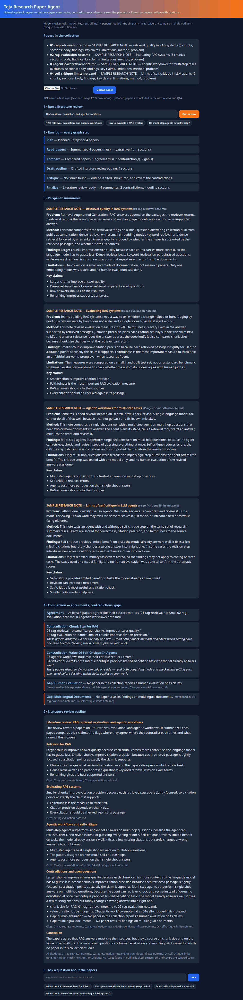

# Teja Research Paper Agent — Product 3

**The problem it solves:** PhD students drown in research papers. Upload a
pile of papers and this agent summarizes each one (problem, method, findings,
limitations), compares them across the pile, flags contradictions and gaps,
and builds an editable literature review outline — with citations to the
exact source paper for every claim.

This is Product 3 of Teja's learn-by-building plan (Product 1: RAG doc
chatbot, Product 2: LangGraph agentic workflow). It combines both: Product 1's
RAG pipeline over paper chunks, and Product 2's LangGraph graph — with new
nodes for reading papers, comparing them, and drafting a literature review.

**Open source:** MIT license. Free for anyone to use, copy, and improve.

## Demo

Screenshot of a real literature review run (mock mode, no API key) over the
4 sample papers — topic "RAG retrieval, evaluation, and agentic workflows",
showing the run log, per-paper summaries, the comparison (1 agreement,
2 contradictions, 2 gaps), and the literature review outline with citations:



## Quick start

```bash
cd krishnateja-research-paper-agent
./run.sh          # creates a venv, installs deps, starts the server
# open http://localhost:8002
```

No API key needed: the app runs in **mock mode** end-to-end (deterministic
extractive summaries from each paper's sections + rule-based comparison).
To use a real LLM, copy `.env.example` to `.env`, add your
`OPENAI_API_KEY` (or the `AZURE_OPENAI_*` variables), and restart — no code
change needed.

## What it does

| Endpoint | What it does |
|---|---|
| `GET /health` | Status, mode, papers loaded |
| `GET /papers` | Papers in the collection (sample + uploaded) |
| `POST /upload` | Upload a paper (`.pdf`, `.txt`, `.md`) — PDF text is extracted with pypdf, then chunked and indexed |
| `POST /review` | Full literature review for a topic: summaries → comparison → outline, through the LangGraph pipeline |
| `POST /ask` | Question answering over the papers, with citations — and it says when the papers disagree |
| `GET /tasks` | Sample topics and questions |

## The graph

```
plan -> read_papers -> compare -> draft_outline -> critique --(issues, <2 revisions)--> draft_outline
                                                      \--(ok / max revisions)--> finalize -> END
```

- **plan** — writes a step-by-step plan for the review.
- **read_papers** — summarizes each paper (problem, method, findings, limitations, key claims) with citations.
- **compare** — finds agreements, contradictions, and gaps across the pile.
- **draft_outline** — builds the literature review outline from the summaries and the comparison.
- **critique** — checks the outline: every citation is a real paper, every section cites papers, contradictions are covered. Issues send it back for revision (max 2).
- **finalize** — validates the whole review against the `ReviewOutput` Pydantic model.

## What Teja learns from this project

1. **RAG over structured documents** — papers have sections, so the agent reads the Findings section for findings instead of treating the paper as one blob.
2. **PDF extraction** — pypdf turns PDFs into text; scanned image PDFs have no text layer, so the upload endpoint rejects them with a clear error.
3. **LangGraph** — the same state/graph pattern as Product 2, with domain-specific nodes. Compare `backend/agent.py` with Product 2's `agent.py` to see what changed and what stayed the same.
4. **Comparison, not just summarization** — a plain chatbot summarizes one paper at a time. A research agent compares papers and flags where they disagree. That is the hard, useful part.
5. **Structured outputs** — `PaperSummary`, `Comparison`, and `LiteratureReview` are Pydantic contracts. A step that breaks the contract is rejected and revised.
6. **Evals** — `python backend/eval.py` runs 5 checks: summaries complete, both designed contradictions found, outline structured and cited, and both Q&A answers grounded and cited. Exit 0 = all passed.

## The sample papers

`data/sample_papers/` has 4 short, invented sample notes (RAG retrieval,
RAG evaluation, agentic workflows, limits of self-critique). They are
**clearly labelled as invented notes, not real published papers** — no
authors, venues, or real results. Two contradictions are built in on
purpose, so you can see the comparison work:

- **Chunk size:** note 1 says larger chunks improve answer quality; note 2 says smaller chunks improve citation precision.
- **Self-critique:** note 3 says self-critique reduces errors; note 4 says it provides limited benefit.

## Try it

1. Open http://localhost:8002 and click a sample topic to run a review.
2. Read the per-paper summaries, then the contradictions — the agent should find both.
3. Ask "What chunk size works best for RAG?" — the answer should show both sides, with citations.
4. Upload a real paper (PDF) and run the review again — it will be included.

## Evals

```bash
python backend/eval.py   # 5/5 expected in mock mode; writes eval_results.json
```

## Stretch exercises

1. **Real embeddings:** swap the keyword retrieval in `backend/papers.py` for ChromaDB + OpenAI embeddings (see Product 1's `rag.py`) and compare eval scores.
2. **PDF upload to review:** upload 3 real papers on your PhD topic and read the outline it builds — then edit the outline by hand. What did the agent miss?
3. **A new contradiction rule:** add an opposition pair to `OPPOSITION_PAIRS` in `backend/agent.py` and a sample note that triggers it, then re-run the eval.
4. **Streaming:** stream the run log to the UI as each graph node finishes, instead of waiting for the whole review.
5. **Export:** add a `/export` endpoint that downloads the literature review outline as Markdown.

## How to use this as a real PhD tool

- Keep your papers in `data/uploads/` (they are git-ignored) and run a review per research question, not per paper.
- Treat the outline as a **first draft**: it is grounded in your papers, but you must check every citation before it goes into a real literature review.
- Treat contradictions as **research questions**, not answers: when two papers disagree, read both methods sections and check which setting each one tested.
- Never let the agent invent a paper: every citation must be a file in your collection. The critique node enforces this — if it ever cites a paper you did not upload, that is a bug, not a feature.
